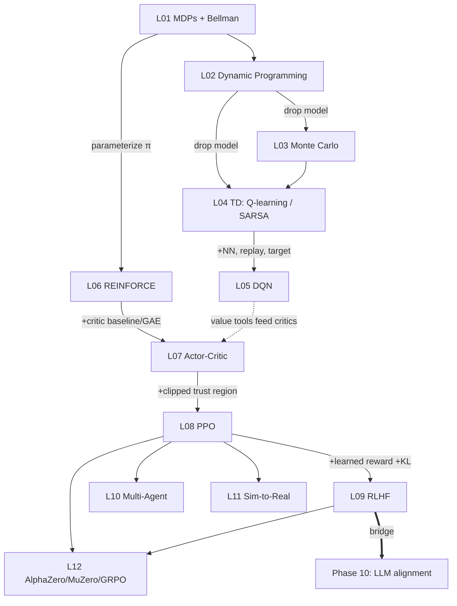

# Phase 09 RL — One-Page Cheat Sheet

> **Thesis:** all RL is *generalized policy iteration* — estimate value → act
> greedier → repeat. (Full version: `PHASE-09-SUMMARY.md`.)

## Core definitions

| Symbol | Meaning |
|---|---|
| MDP | `(S, A, P, R, γ)`, Markov: next state depends only on `(s,a)` |
| Return | `G_t = r_{t+1} + γ r_{t+2} + γ² r_{t+3} + …`   (`γ∈[0,1)`) |
| `V^π(s)` | expected return from `s` under `π` |
| `Q^π(s,a)` | expected return taking `a` in `s`, then `π`  (depends on `π`) |
| `Q*(s,a)` | `max_π Q^π` — the policy-independent optimum |
| Bellman | `Q^π(s,a) = E[ r + γ Q^π(s',a') ]` |
| Advantage | `A(s,a) = Q(s,a) − V(s)` ("how much better than average") |

## The naming cube (any algorithm = one point)

```
model-based ── vs ── model-free      (know P,R?  → DP, else sample)
   MC       ── vs ── TD              (full return vs 1-step bootstrap)
value-based ── vs ── policy-based    (argmax Q vs trained π_θ)
```

## Update rules (the whole phase in formulas)

| Method | Lesson | Update / loss (↑ = maximize) |
|---|---|---|
| Value iteration | 02 | `V(s) ← max_a E[r + γV(s')]` |
| Monte Carlo | 03 | `V(s) ← V(s) + α(G_t − V(s))` |
| TD(0) | 04 | `V(s) ← V(s) + α(r + γV(s') − V(s))`  ← TD error δ |
| **Q-learning** (off-policy) | 04 | `Q(s,a) += α(r + γ·max_a' Q(s',a') − Q(s,a))` |
| **SARSA** (on-policy) | 04 | `Q(s,a) += α(r + γ·Q(s',a'_taken) − Q(s,a))` |
| DQN | 05 | `min ‖Q_θ(s,a) − (r + γ max Q_θ⁻(s'))‖²` + replay + target net |
| REINFORCE | 06 | `↑ E[ G_t · ∇log π_θ(a|s) ]` |
| A2C | 07 | `↑ E[ A_t · ∇log π_θ ]`, `A_t` via GAE, critic `V_φ` |
| **PPO** | 08 | `↑ min(r_t·A_t, clip(r_t,1±ε)·A_t) − c_v(V_φ−V_tgt)² + c_e H` |
| RLHF | 09 | PPO with reward `= RM(x) − β·KL(π_θ‖π_ref)`; RM: `−log σ(r_win−r_lose)` |
| GRPO | 12 | `↑ E[ A_i · log π ] − β·KL`, `A_i = (r_i − mean)/std` (no critic) |

`r_t(θ) = π_θ(a|s) / π_θold(a|s)` (PPO ratio).  Negate any ↑-objective to feed a minimizer.

## Decisions at a glance

- **Know the model?** → DP (exact). Else → sample (MC/TD).
- **Big/continuous actions?** → policy-based (can't `argmax Q`).
- **Exploration risky at deploy?** → SARSA (on-policy) over Q-learning.
- **PG too noisy?** → add critic baseline (A2C) → clip steps (PPO).
- **No hand-coded reward?** → learn one (RLHF); **verifiable reward?** → GRPO.
- **Many agents?** → CTDE (central critic, decentralized actors).

## Gotchas

- `max` in Q-learning = off-policy **and** overestimation bias (→ Double DQN).
- DQN needs **both** replay (decorrelate) **and** target net (stable target).
- PG: advantages & value targets are **detached** — grad flows only through `π_θ`,`V_φ`.
- PPO clip = **trust region**: zero gradient once the ratio leaves `1±ε` helpfully.
- RLHF **KL leash** = the anti-reward-hacking safety valve.

## The grand map


