# Phase 09 — Reinforcement Learning: Knowledge Map & Key Takeaways

> **The whole phase in one sentence:** every RL method is *generalized policy
> iteration* — estimate how good things are (value), then make the policy
> greedier with respect to that estimate — and the lessons differ only in (a)
> whether you have a model, (b) how you estimate value, and (c) how you represent
> and improve the policy. RLHF/GRPO at the end is this same machinery pointed at
> language models.

This document synthesizes all 12 lessons. Flowcharts are [Mermaid](https://mermaid.js.org/)
(render on GitHub, VS Code with a Mermaid extension, or Obsidian).

---

## 0. The lessons at a glance

| # | Lesson | Model? | Value est. | Policy | One-line idea |
|---|---|---|---|---|---|
| 01 | MDPs | — | — | — | states, actions, rewards, `γ`; the Bellman equation |
| 02 | Dynamic programming | **known** | exact sweeps | greedy | policy/value iteration — the "cheating" benchmark |
| 03 | Monte Carlo | free | full returns `G` | ε-greedy | learn from complete episodes, no bootstrap |
| 04 | TD: Q-learning & SARSA | free | 1-step bootstrap | ε-greedy | update every step; off- vs on-policy |
| 05 | DQN | free | bootstrap + NN | ε-greedy | Q-table → neural net + replay + target net |
| 06 | REINFORCE | free | returns as weight | **parameterized** | optimize the policy directly by gradient ascent |
| 07 | Actor-Critic (A2C) | free | critic + GAE | parameterized | a learned baseline cuts REINFORCE's variance |
| 08 | PPO | free | critic + GAE | parameterized | clip the update to a trust region: stable PG |
| 09 | Reward modeling + RLHF | free | group/critic | parameterized | learn a reward from preferences, then PPO against it |
| 10 | Multi-agent RL | free | per-agent/joint | parameterized | many learners; non-stationarity; CTDE |
| 11 | Sim-to-real | free | (uses PPO) | parameterized | cross the reality gap: randomize, adapt, identify |
| 12 | RL for games | both | search + NN | distilled/PG | AlphaZero · MuZero · GRPO (self-play + search) |

---

## 1. The one framework everything hangs on

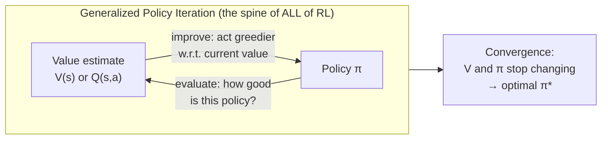

Every algorithm in this phase is a way to run this loop when you **cannot** do
the exact Bellman sweeps of dynamic programming. The three big design axes:

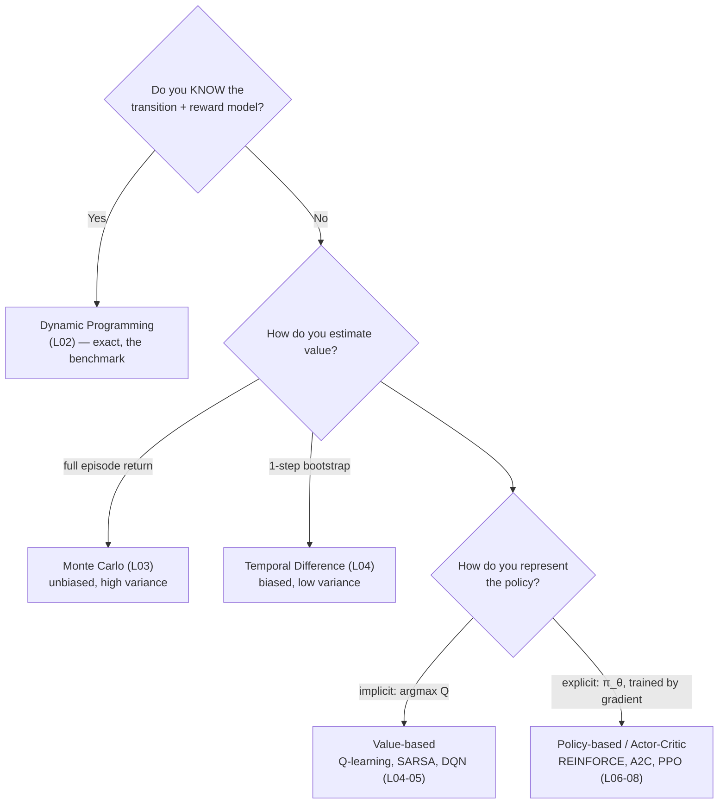

**Takeaway:** "model-based vs model-free", "MC vs TD", and "value-based vs
policy-based" are the three independent choices that *name* every RL algorithm.

---

## 2. The MDP foundation (L01)

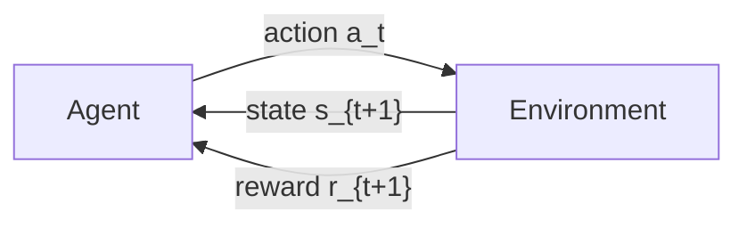

- **MDP** = `(S, A, P, R, γ)`. The **Markov property**: the next state depends
  only on the current state+action, not the full history.
- **Return** `G_t = r_{t+1} + γ r_{t+2} + γ² r_{t+3} + …` — discounted future
  reward. `γ ∈ [0,1)` makes the infinite sum finite and encodes "how far-sighted".
- **Value functions** — expected return:
  - `V^π(s)` = expected return from state `s` following `π`.
  - `Q^π(s,a)` = expected return from taking `a` in `s`, then following `π`.
- **Bellman equation** (the recursion everything iterates):
  `Q^π(s,a) = E[ r + γ · Q^π(s', a') ]`.

**Key takeaway:** `Q` depends on the policy (the "then follow `π`" part). The
special policy-independent fixed point `Q*(s,a) = maxπ Q^π(s,a)` is what optimal
methods target.

---

## 3. Dynamic programming — RL "with cheating" (L02)

When `P` and `R` are known, iterate Bellman to a fixed point:

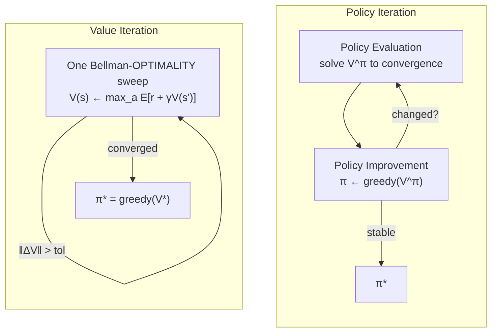

- **Why it converges:** the Bellman operator is a **γ-contraction** in sup-norm
  → unique fixed point, geometric convergence. Drop `γ<1` and you need a terminal
  state instead.
- **GPI** is the unifying idea: policy iteration and value iteration are just
  different interleavings of evaluate↔improve. So are Q-learning and PPO.

**Takeaway:** DP is the gold-standard answer you compare sampling methods to. The
rest of the phase is "how to do GPI when you *can't* sweep the whole model."

---

## 4. Model-free value estimation: MC vs TD (L03–L04)

The core split in how to estimate value **without a model**:

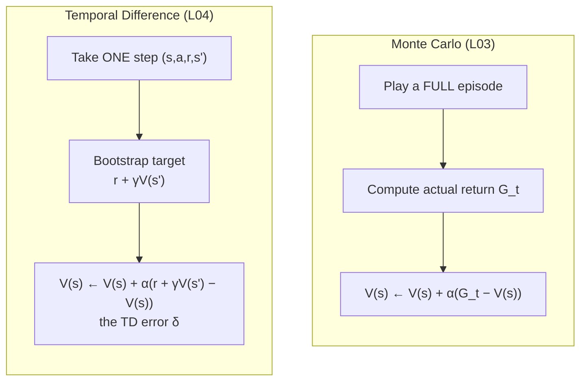

| | Monte Carlo | Temporal Difference |
|---|---|---|
| Update when? | end of episode | every step |
| Target | real return `G` | `r + γV(s')` (estimate) |
| Bias / variance | **unbiased**, high variance | **biased**, low variance |
| Needs episodes to end? | yes | no |

### On-policy vs off-policy (the L04 payoff)

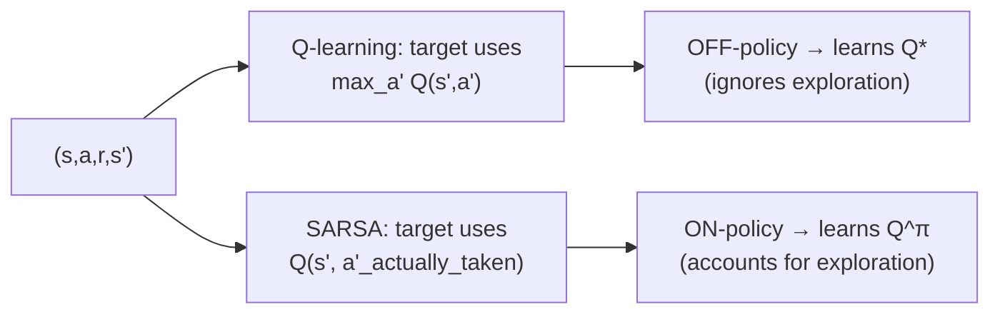

- **Q-learning** (`max`): learns the optimal `Q*` regardless of the behavior
  policy → **off-policy**.
- **SARSA** (actual next action): learns `Q^π` for the ε-greedy policy it runs →
  **on-policy**, more conservative when exploration is risky (the cliff-walking
  example).

**Takeaway:** bootstrapping (using your own estimate in the target) is the pivot
from MC to TD and underlies *every* deep-RL method after this. The single `max`
symbol is the entire difference between off- and on-policy control.

---

## 5. Deep value-based RL: DQN (L05)

Replace the Q-**table** with a Q-**network** — and add two tricks to stop it
diverging:

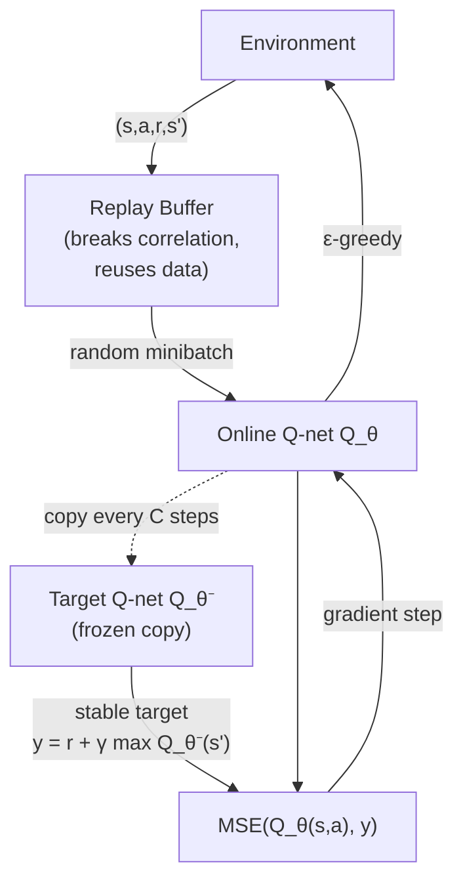

- **Replay buffer** → decorrelates samples and reuses experience (sample
  efficiency).
- **Target network** → a slowly-updated copy provides a *stable* bootstrap
  target, preventing the "chasing a moving target" divergence.
- **Maximization bias** (the `max` over noisy Q) → fixed by Double DQN.

**Takeaway:** DQN = tabular Q-learning + function approximation + the two
stabilizers. This is where "deep RL" begins.

---

## 6. Policy-gradient methods: REINFORCE → A2C → PPO (L06–L08)

Instead of deriving the policy from `Q` (argmax), **parameterize `π_θ` directly**
and ascend the expected-return gradient. This is mandatory for large/continuous
action spaces and is the family RLHF uses.

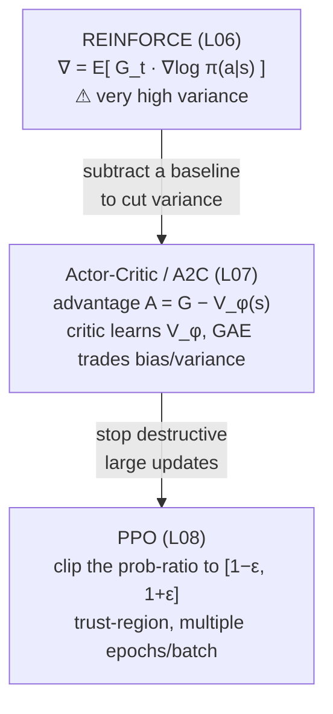

### The score-function gradient (the shared engine)

Every method here computes the same `∇ log π(a|s)` and **weights** it by some
measure of "was this action better than expected":

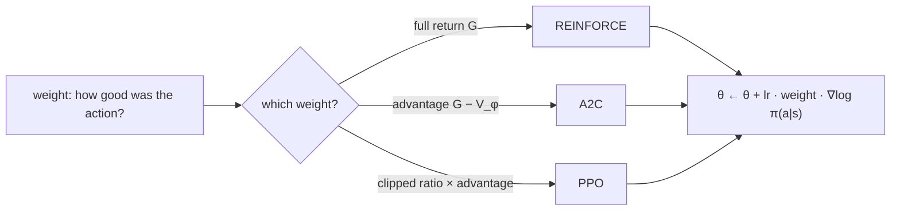

### PPO's clipped objective (the L08 heart)

```
L^CLIP(θ) = E[ min( r_t(θ)·A_t , clip(r_t(θ), 1−ε, 1+ε)·A_t ) ]
            r_t(θ) = π_θ(a|s) / π_θold(a|s)     (probability ratio)
```

Full loss (an **objective to maximize**; negate it to feed a minimizer):

```
L = L^CLIP − c_v·(V_φ − V_target)²  + c_e·H(π)
    policy    value regression        entropy bonus (exploration)
```

- The `clip` creates a **trust region**: if an action's probability already moved
  past `1±ε` in the helpful direction, its gradient is zeroed — no runaway update.
- **Actor-critic structure:** separate nets (robust) or a shared backbone
  (sample-efficient, but the actor & critic gradients *sum* on shared weights →
  tune `c_v`, clip grads, or decouple).
- **Detach discipline:** advantages and value targets are constants w.r.t. the
  gradient — gradient flows only through `π_θ` and `V_φ`, never through the target.

**Takeaway:** the progression is a **variance-reduction + stability** story.
REINFORCE is correct but noisy; the critic baseline tames variance; PPO's clip
tames step size. PPO is the workhorse — and the bridge to RLHF.

---

## 7. Reward modeling + RLHF (L09) — RL meets LLMs

When there is no hand-coded reward, **learn one from human preferences**, then
optimize against it with PPO + a KL leash.

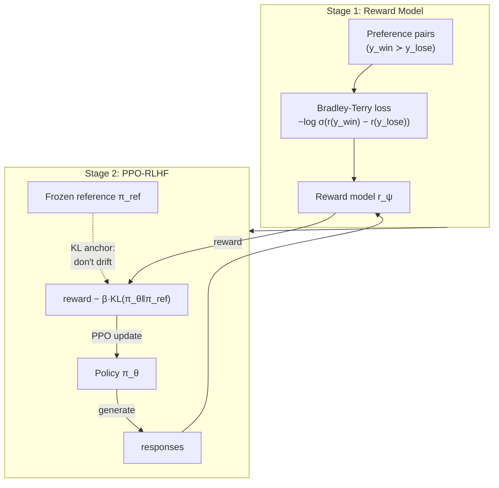

- **Reward model** = pairwise-logistic (Bradley-Terry) scorer over a reward head.
- **KL-to-reference penalty** keeps the policy from hacking the reward model into
  gibberish — the central safety valve of RLHF.
- **This is literally the PPO of L08** with a *learned* reward replacing the
  environment reward.

**Takeaway:** `reward = RM(x) − β·KL(π‖π_ref)` is the objective that aligns
real LLMs (Phase 10 builds on it). RL stopped being just for games here.

---

## 8. Multi-agent RL (L10)

Many agents learning at once breaks the single-agent assumption:

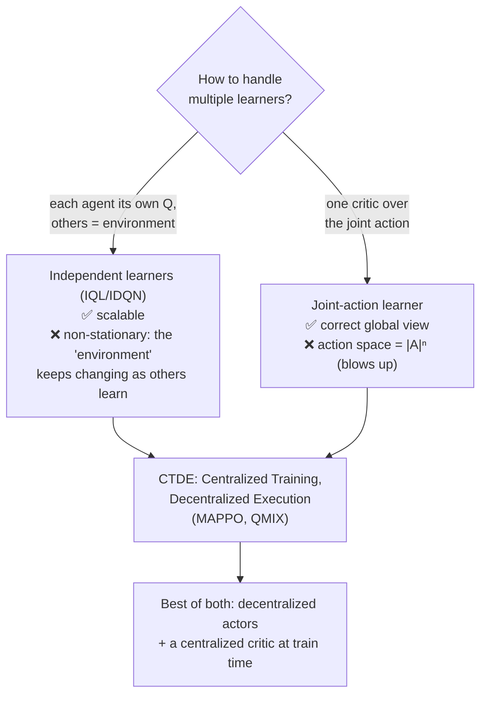

**Takeaway:** the core tension is **non-stationarity** (independent) vs
**exponential blow-up** (joint). **CTDE** resolves it: train with a centralized
critic that sees everything, execute with small decentralized actors.

---

## 9. Sim-to-real transfer (L11)

A policy that only works in the simulator "memorized the simulator." Close the
**reality gap**:

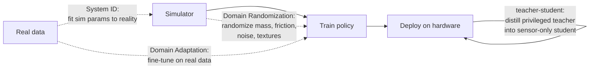

- **Domain Randomization** — train across a distribution of sims so reality falls
  inside the envelope.
- **System Identification** — measure reality, set sim params to match.
- **Domain Adaptation** — fine-tune on a little real data.
- **Massively parallel sim** (Isaac Lab, MJX, Brax) makes DR nearly free: 4,096
  randomized envs on one GPU, PPO collects "years" of experience in hours.

**Takeaway:** generalization across a *distribution* of environments is what
transfers — and PPO (L08) is the engine underneath.

---

## 10. RL for games: AlphaZero · MuZero · GRPO (L12)

The capstone unifies search-based RL and modern LLM-reasoning RL under one loop:

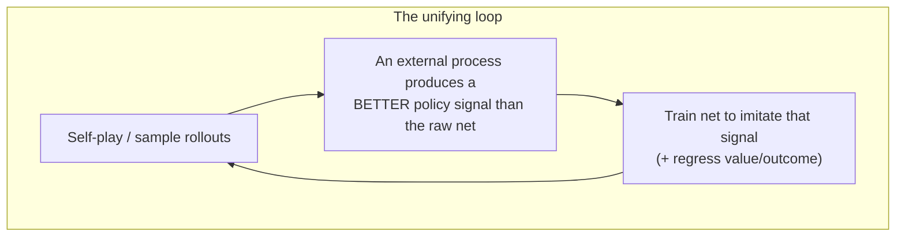

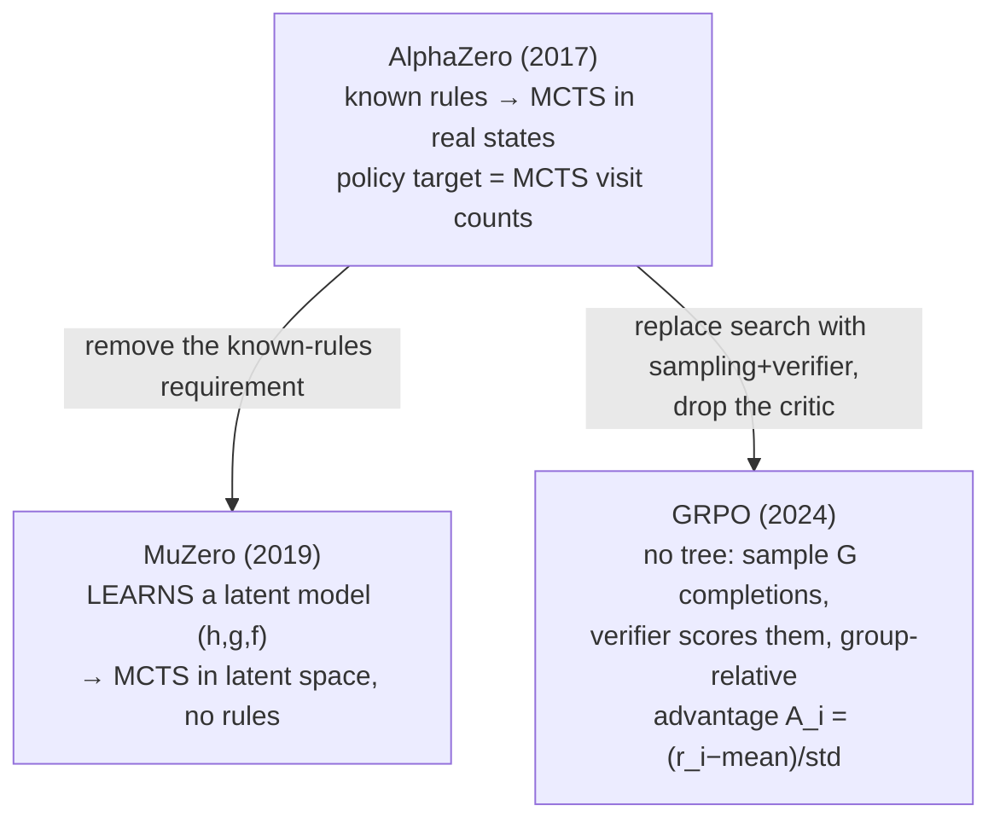

- **AlphaZero**: `improver` = MCTS lookahead; net distills its own search; needs
  a perfect simulator (the rules).
- **MuZero**: learns a latent dynamics model so it can plan *without* the rules
  — one algorithm for Go, chess, shogi, and Atari.
- **GRPO** (DeepSeek-R1): the search-free case — parallel sampling + a verifier
  replaces the tree, and the **group mean/std** replaces the critic. This is how
  LLMs are trained to reason (tokens = actions, correct answer = win).

**Takeaway:** *acquire a stronger-than-network policy signal from an external
process (search or verified sampling), then imitate it.* Search-based methods
rule long-horizon perfect-information games; GRPO rules verifiable LLM reasoning.

---

## 11. The grand map (how every lesson connects)

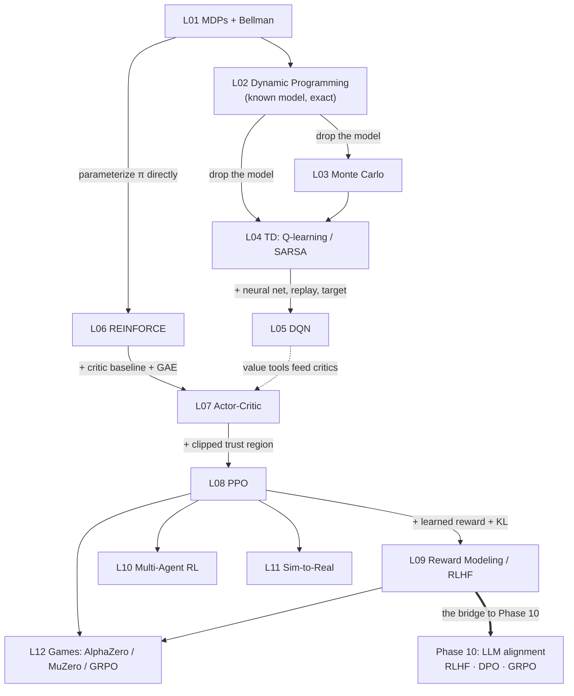

---

## 12. Ten key takeaways to remember

1. **Everything is GPI.** Estimate value → act greedier → repeat. DP does it
   exactly; everyone else approximates.
2. **Three naming axes:** model-based vs free · MC vs TD · value- vs
   policy-based. Any algorithm is one point in this cube.
3. **`Q` depends on the policy;** `Q*` is the policy-independent optimum.
   Off-policy methods (Q-learning) target `Q*` directly via the `max`.
4. **Bootstrapping** (TD) trades bias for a huge variance reduction and enables
   online, non-episodic learning — the foundation of all deep RL.
5. **DQN = Q-learning + NN + replay + target net.** The two stabilizers are what
   make function approximation not diverge.
6. **Policy gradients** optimize `π_θ` directly; the series REINFORCE → A2C → PPO
   is a **variance-reduction then step-size-control** story.
7. **PPO's clip = a trust region.** Small, safe policy steps; it's the workhorse
   and the base of RLHF.
8. **RLHF = PPO against a learned reward, leashed by KL** to a reference. The KL
   term is the anti-reward-hacking safety valve.
9. **Multi-agent's dilemma** is non-stationarity vs |A|ⁿ blow-up; **CTDE** is the
   resolution (central critic, decentralized actors).
10. **The 2024-26 frontier (GRPO)** is AlphaZero's recipe with sampling+verifier
    instead of a tree and a group baseline instead of a critic — RL's center of
    gravity moved from games to LLM reasoning.

---

## 13. Hands-on artifacts in this phase (companion code)

- PyTorch ports built alongside the lessons: DQN (L05), REINFORCE (L06),
  Actor-Critic + shared-backbone variant (L07), PPO (L08), Reward-Model/RLHF
  (L09), and deep Independent-vs-Joint DQN (L10) — each `code/main_torch.py`.
- Deep-dive explainer: `12-rl-for-games/docs/alphazero-muzero-grpo.md`.
- Working experiment: `12-rl-for-games/capstone/` — a verifiable AlphaZero on
  Tic-Tac-Toe (never loses to perfect play; search-vs-no-search ablation).
```
